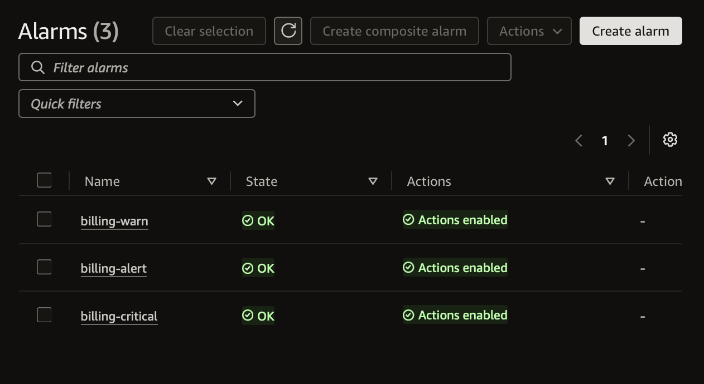

# Billing Alarms

**Date:** 2026-11-15
**Phase:** 1 – Account Foundations

## What I built
Three CloudWatch billing alarms on the `EstimatedCharges` metric (us-east-1),
each notifying an SNS topic that emails me.

| Alarm name | Threshold | Purpose |
|---|---|---|
| billing-warn | $5 | Early warning |
| billing-alert | $25 | Something is running that shouldn't be |
| billing-critical | $100 | Stop and investigate now |

## Why it matters
Cost guardrails are an early control in any landing zone. In federal environments
they support budget accountability and help catch unauthorized resource use.

## Steps
1. Enabled "Receive Billing Alerts" in Billing preferences
2. Created SNS topic + confirmed email subscription
3. Created 3 alarms in CloudWatch (us-east-1)

## Evidence

## Lessons learned
- Billing metrics only exist in us-east-1
- An SNS topic is not the alarm. The alarm watches the metric and decides when to fire.
  The SNS topic is the notification channel it sends to, and the subscription
  (my email) is who receives it. I originally thought the topic name was the alarm name.
- CloudWatch alarm names can't be edited after creation. To rename one, you have to
  delete it and recreate it, so pick a naming convention before you build.
