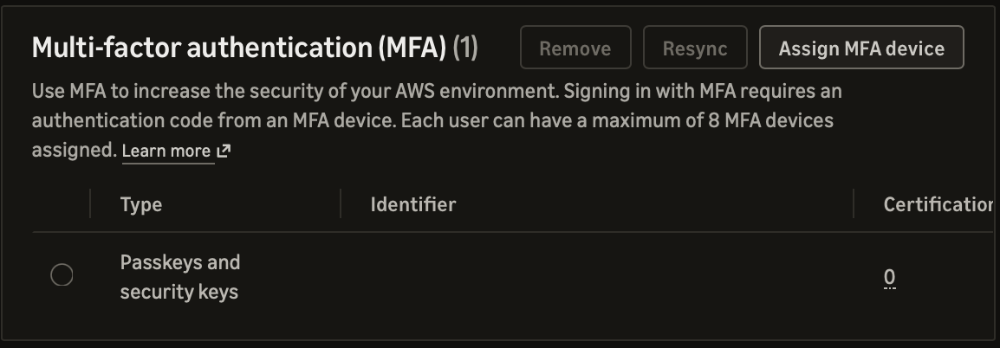
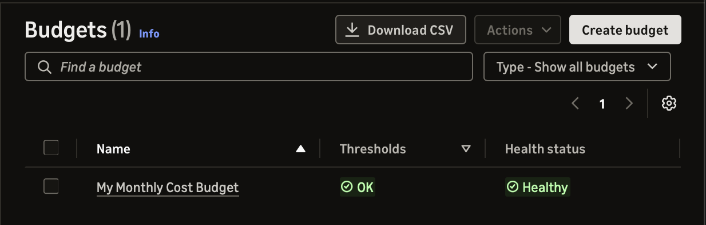

# Account Security: MFA, IAM Admin, and AWS Budget

**Date:** 2026-11-15
**Phase:** 1 – Foundations

## What I built
- MFA enabled using a passkey (phishing-resistant) on the root user and IAM admin user
- Created an IAM admin user for daily work; root is used only for root-only tasks
- Enabled IAM user access to Billing so the admin user can manage costs without root
- Monthly AWS Budget at $25 with email alerts on actual and forecasted spend

## Why it matters
Root has unrestricted access to the account and can't be limited by IAM policies.
Protecting it with strong MFA and not using it day to day is a baseline control in
every federal framework. Passkeys are phishing-resistant, aligned with federal
zero-trust guidance (OMB M-22-09) that favors them over SMS or one-time codes.

| Control | NIST 800-53 | What I did |
|---|---|---|
| Multi-factor authentication | IA-2(1) | Passkey MFA on root and admin user |
| Least privilege / no daily root use | AC-6 | Separate IAM admin user |
| Cost monitoring | (operational) | AWS Budget + billing alarms |

## Steps
1. Root → Security credentials → assigned a passkey as the MFA device
2. IAM → created `yig-admin` with AdministratorAccess, Billing, and IAMUserChangePassword; assigned MFA
3. Root → Account → enabled "IAM user and role access to Billing information"
4. Signed in as `yig-admin` → Billing → Budgets → created a monthly cost budget

## Budget vs. billing alarms
Billing alarms fire after money is already spent. A Budget can also alert on
forecasted spend, so it warns earlier. I use both.

## Evidence

## Lessons learned
- IAM users can't access Billing by default, even with AdministratorAccess.
  Root has to enable "IAM user and role access to Billing information" first,
  and that switch grants nothing by itself; the user's policies still apply.
- The Billing policy is redundant alongside AdministratorAccess.
- The "Certifications" column for MFA only applies to FIDO-certified hardware keys;
  a platform passkey shows 0, and that's expected.
- AdministratorAccess is broad. In Phase 2 I'll replace it with IAM Identity Center
  permission sets (admin / operator / reader) to enforce least privilege (AC-6).

## References
- [AWS IAM User Guide – Setting up your AWS account](https://docs.aws.amazon.com/IAM/latest/UserGuide/getting-started-account-iam.html)
